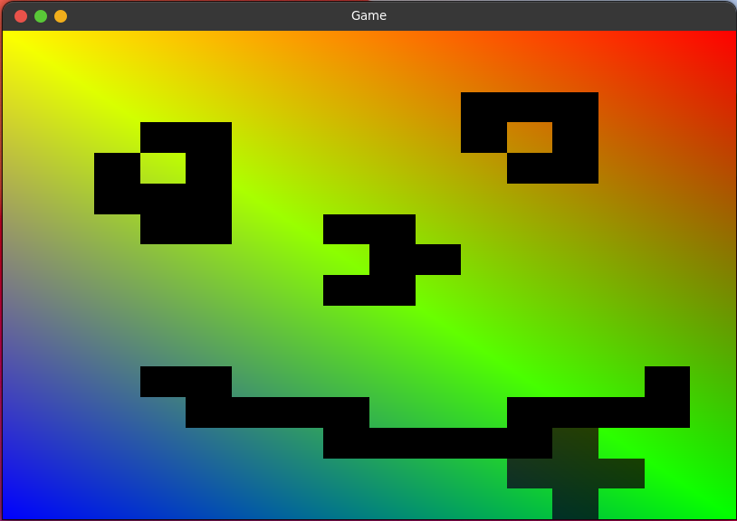

# RustGL for Gurkha Launcher

<p align="center"></p>

The **RustGL** renderer - a desktop-OpenGL-to-OpenGL-ES compatibility layer
written in Rust - and the packager that turns it into a **universal renderer
plugin APK** for Minecraft: Java Edition launchers on Android.



## What is in this repository

| Path | What it is |
|---|---|
| `rustgl/` | The renderer: a Rust workspace whose `gl-compat` crate builds the renderer; packaging ships it as `librustgl.so`. Synced from [`Gurkha Launcher`](https://github.com/kushaladhikari982648-lgtm/Gurkha-launcher) (`rustgl/`, branch `arena/a8e9723f-gurkha-launcher`, commit `1726782a`) plus the local changes listed in `renderer-source.json` - see [`docs/PERFORMANCE.md`](docs/PERFORMANCE.md). `python3 tools/check_sync.py` proves every other file is byte-identical. |
| `android-plugin/` | The plugin: `AndroidManifest.xml` (RendererPlugin v2 + v1 meta-data), the v2 JSON config, and the single information `Activity`. |
| `tools/` | `package_apk.py` (aapt2 + javac + d8 + zipalign + apksigner, no Gradle), `verify_apk.py` (post-build contract checks), `collect_native.py`, `check_sync.py`. |
| `tests/` | Contract tests for the manifest, the v2 config and the packaging helpers - plain Python, no SDK. |
| `src/`, `res/` | The original desktop RustGL demo (SDL2 + OpenGL) this repository started as. Kept for reference; it is not part of the Android plugin. |
| `docs/UNIVERSAL_APK.md` | Install, per-launcher notes, environment variables, limitations, the Minecraft 26.x situation (Vulkan renderer, the SDL3 switch), signing and rebuild instructions. |
| `docs/POJAV_EGL_LWJGL.md` | Why LWJGL throws "There is no OpenGL context management API available" on Pojav and how it is fixed: what LWJGL dlopens, what Pojav sets and strips, the EGL sequence and the value each call must return, how to force EGL explicitly, and the debug flags. |
| `docs/SDL3_LAUNCHERS.md` | What a launcher must provide for Minecraft 26.3+ now that the game uses SDL3 instead of GLFW: the SDL3 library, the `SDL_EGL_LIBRARY` hint that routes it to this renderer, what this layer normalises, and the state of SDL3 support in the launchers this APK targets. |
| `docs/PERFORMANCE.md` | What was optimized in the renderer (per-call locking, shader translation caching, compile/link stalls, per-draw allocations), how the driver capability tiers work, how **shader packs** work on this renderer (OptiFine 1.7.10-1.12.2 and Iris/Sodium), and what is **not** measured. |

## Shader packs

OptiFine-style packs for 1.7.10-1.12.2 - the ones the weakest devices are stuck
on - draw with `glVertexPointer`/`glColorPointer` and read `gl_Vertex`,
`gl_MultiTexCoord0` and `gl_ModelViewProjectionMatrix` in their GLSL. GLSL ES has
none of those, so the renderer translates them onto attributes and uniforms it
feeds from the vertex arrays and matrix stacks it already tracks, and advertises
the extensions packs probe (`GL_ARB_shader_texture_lod` and friends) so they
enable their real code path instead of a fallback. Modern Iris and Sodium packs
(GLSL 330, `texelFetch`, MRT) are untouched by that translation and take the
path they always did.

Geometry, tessellation, compute, image load/store and SSBOs have no ES 3.x
equivalent and are still rejected with a logged reason rather than rendering
black. Twenty shader fixtures - six of them the pack dialects above - compile on
a real GLES driver in CI on every push. What is **not** verified is a pack
running end to end on a phone; see the closing section of
[`docs/PERFORMANCE.md`](docs/PERFORMANCE.md#what-is-not-claimed).

## The universal APK

`rustgl-universal-<version>.apk` ships `librustgl.so` for **arm64-v8a,
armeabi-v7a, x86 and x86_64** in one package and declares the plugin contracts
used by the Pojav-family launchers, so the same file can be installed and
selected as a renderer in:

* **Zalith Launcher 2** and its forks (TurboCraft, Cubiq, Hyper Launcher v3 …)
* **Zalith Launcher 1 / Gurkha Launcher** and their forks
* **FCL (Fold Craft Launcher)** and **NuxLauncher**
* **Pojav Glow·Worm lineage**: PojavLauncher-Beta-Zink, NRC for Android
* **H2CO3 Launcher** and the Boat family (`h2co3LauncherPlugin` + `h2co3Env`)
* launchers with no plugin loader at all, through the per-ABI ZIP or the
  local-import ZIP published next to it

All of those launchers discover plugins with
`PackageManager.queryIntentActivities(Intent.ACTION_MAIN)`, so the APK also
contains a tiny exported `Activity` that explains the plugin - that is what makes
it visible to them, and the reason this plugin is not a pure native package.

Each launcher family looks for a different marker, and the APK declares all of
them: `fclPlugin_V2` (v2 JSON config), `fclPlugin`, `zalithRendererPlugin`,
`pgwRendererPlugin`, `h2co3LauncherPlugin` + `h2co3Env`, plus `boatEnv`,
`renderer`, `des`, `pojavEnv`, `minMCVer` and `maxMCVer`. The renderer id is
`opengles3`, the value those launchers already recognise for an OpenGL ES 3
renderer.

**Download:** <https://github.com/kushaladhikari982648-lgtm/RustGL-for-Gurkha-launcher/releases/latest>
- install `rustgl-universal-<version>.apk` (2.3 MB, four ABIs in one file),
- or `rustgl-local-import.zip` for launchers that import renderer folders,
- or `rustgl-gurkha-<abi>.zip` for a bare `librustgl.so`.

Install, selection and honest limitations: **[docs/UNIVERSAL_APK.md](docs/UNIVERSAL_APK.md)**.

## Build it yourself

GitHub Actions does all of it (`.github/workflows/android.yml`): host renderer
tests against Mesa software GLES, a `cargo-ndk` build for four ABIs, the APK,
its contract verification, and - on a `v*` tag - the release with checksums.

Locally, with Rust, the Android NDK and the Android SDK:

```sh
cd rustgl
cargo test -p renderer-core -p gl-compat -p shader-translate -- --test-threads=1
cargo ndk -t arm64-v8a -t armeabi-v7a -t x86 -t x86_64 build --release -p gl-compat
cd ..
python3 tools/collect_native.py --target rustgl/target --output artifacts/rustgl
python3 tools/package_apk.py --sdk "$ANDROID_HOME" --output artifacts/release
python3 tools/verify_apk.py artifacts/release/*.apk --sdk "$ANDROID_HOME"
python3 -m unittest discover -s tests -v
```

Set `APK_KEYSTORE_BASE64`, `APK_KEYSTORE_PASSWORD` and `APK_KEY_ALIAS` to sign
with a persistent key; without them the packager generates a one-build key and
prints a warning (a later build then needs the plugin uninstalled first).

## Updating the renderer

Re-sync `rustgl/` from Gurkha Launcher, then record the new tree hash in
`renderer-source.json` (`python3 tools/check_sync.py --record`) and bump
`versionCode`/`versionName` in `android-plugin/AndroidManifest.xml`.

## Licences

The packaging tooling (`android-plugin/`, `tools/`, `tests/`) is MIT licensed;
see [`NOTICE`](NOTICE). The renderer in `rustgl/` comes from
[`whaltermc/rust-renderer`](https://github.com/whaltermc/rust-renderer) (revision
`eb22559`) via Gurkha Launcher and **upstream publishes no licence file** - until
it does, that code is redistributed as "used with the author's permission" and
is not covered by the MIT grant. Keep `NOTICE` with any copy.
